# Clawd: a pet crab for Claude Code

Clawd is a small pixel crab that lives above your prompt in Claude Code. It watches Claude work
and reacts to it. It puts on glasses to read, gets dizzy when tests fail, and throws confetti
when Claude commits your work.

<p align="center"></p>

Clawd is a plugin for Claude Code. It works in the terminal, in VS Code and in the Claude desktop
app. **By default, Clawd uses no tokens.** It runs on your computer and adds nothing to your
requests to Claude. Clawd is an unofficial fan project. Anthropic did not make or endorse it.

## Install

You need Claude Code 2.1.312 or later. To see your version, run `claude --version`. You do not
need to install anything else.

**The easy way:** in Claude Code, send this prompt:

> Install the Clawd mod from https://github.com/arduR-O/clawd-pet

Claude runs the steps for you. It asks for your time zone.

**To install it yourself:**

1. In your terminal, outside Claude Code, run:

   ```sh
   claude plugin marketplace add arduR-O/clawd-pet
   ```

2. Run:

   ```sh
   claude plugin install clawd@clawd
   ```

   `clawd@clawd` means "the plugin `clawd` from the marketplace `clawd`". A marketplace is a list
   of plugins. This repository is a marketplace with one plugin in it.
3. In Claude Code, run `/plugin configure clawd@clawd`.
4. Set **UTC offset** to your time zone, for example `+05:30` or `-07:00`. Clawd uses it to show
   day and night. If you skip this step, Clawd uses UTC.
5. In Claude Code, run `/reload-plugins`.

Clawd appears above the prompt, with its name and what it says next to it. It uses four rows of
the screen. In VS Code and the desktop app, Clawd is a picture.

If Clawd does not appear, see [Troubleshooting](#troubleshooting).

## What Clawd does

**It reacts to Claude.**

- When Claude reads a file, Clawd puts on reading glasses.
- When Claude commits your work, Clawd throws confetti.
- When a tool fails, Clawd winces. After two failures in a row, it facepalms. After three, it
  gets dizzy.
- When Claude finishes a prompt, Clawd celebrates. After more than two minutes of work, it
  throws confetti.
- While Claude thinks, Clawd reacts to the word on the spinner. For example, it meditates for
  "Pondering…".

**It reacts to you.**

- When you type, its eyes follow the cursor.
- When you allow a permission request, Clawd thanks you. When you refuse one, it shrugs.
- After 50 minutes of work, Clawd stretches and tells you to take a break.
- If you set a leave time, Clawd counts down to it and tells you to go home.

**It has a life of its own.**

- A sun or a moon moves over its head with your local time.
- It sings lines from songs. With Last.fm, it sings the music that you listen to.
- It builds a sandcastle. Each prompt that Claude finishes adds one level. A new day starts a new
  sandcastle.
- When you send no prompt for 5 minutes in the day, Clawd fishes, juggles, builds or listens to
  music. After 25 minutes, or at night, it takes a nap.
- While you read Claude's answer, Clawd keeps still.

**Claude can talk to it, if you want.** Turn on the **Claude can talk to Clawd** setting. Then
Claude can make Clawd act, sing or say how it is, two times per prompt at most. This setting is
off by default because it adds tokens to each request. See [Costs and privacy](#costs-and-privacy).

<p align="center"></p>

## Guests

Sometimes a guest comes. Each guest comes for a reason:

| Guest | Name to type | When it comes |
|---|---|---|
| Sherlock, in a deerstalker | `sherlock` | Claude runs `git blame`, `git bisect` or `git log -S`, or searches the code three times in a row. |
| A Jedi with a lightsaber | `jedi` | Claude runs `git push --force`. *"Use the --force, Luke."* |
| Gandalf | `gandalf` | You refuse a destructive command, such as `rm`, at a permission request. *"You shall not pass!"* |
| The Terminator | `terminator` | Claude runs `kill`, `pkill` or `killall`. |
| A DeLorean, the time machine | `delorean` | Claude goes back in time: `git revert`, `git reflog`, `git reset` without `--hard`, or a checkout of an old commit. |
| A ninja | `ninja` | Claude runs `git stash`. Clawd dresses in black and hides in a puff of smoke. It comes back for `git stash pop`. |
| A rubber duck | `duck` | You write a prompt of 280 characters or more about a bug. |
| Neo, from The Matrix | `neo` | Claude loads a skill, such as pdf. *"I know pdf."* |
| A mug of coffee | `coffee` | You send your first prompt of the day between 05:00 and 11:00. |
| An astronaut | `astronaut` | Claude stops because of an API error. Clawd puts on a white spacesuit and helmet. *"Houston, we have a problem."* |
| A 1-UP mushroom | `oneup` | The tests pass after they failed earlier for the same prompt. |
| A whale | `whale` | Claude runs `docker` or `podman`. |

`git reset --hard` and `rm -rf` get a warning from Clawd, not a guest.

<p align="center"></p>

To see a guest now, run `/pet` and its name, for example `/pet sherlock`. To see a random guest,
run `/pet guest`.

## Commands

To pet Clawd in the terminal, click it or its name. Clicks need a terminal that sends mouse clicks.
In VS Code and the desktop app, or if your terminal does not send clicks, run `/pet`.

All commands start with `/pet`. When you type `/pet `, Claude Code shows what can come next.

| Command | What it does |
|---|---|
| `/pet` | Pets Clawd. If you pet it 6 times in 10 seconds, it gets annoyed. |
| `/pet treat` | Gives Clawd a treat. |
| `/pet trick` | Makes Clawd do a trick. |
| `/pet guest` | Brings a random guest. The same guest does not come two times in a row. |
| `/pet <emote>` | Shows an emote now, for example `/pet meditate`. See [All emotes](#all-emotes). |
| `/pet refresh-songs` | Writes a new songbook now, and tells you if it cannot. See [The songbook](#the-songbook). |
| `/pet off` | Hides Clawd in all sessions. `/pet on` shows it again. |

### All emotes

`wave`, `dance`, `bubbles`, `sidestep`, `peek`, `snack`, `sunbathe`, `shades`, `glasses`,
`stargaze`, `wish`, `yawn`, `hearts`, `hop`, `wiggle`, `blush`, `shy`, `bow`, `golden`, `enough`,
`milestone`, `sixseven`, `seagull`, `molt`, `cousin`, `pearl`, `tide`, `party`, `treat`,
`meditate`, `uwu`, `stretch`, `facepalm`, `squish`, `rain`, `hiccup`, `fish`, `juggle`, `castle`,
`sing`, `vibe`, `chef`, `hardhat`, `cry`, `spin`, `dizzy`, `tap`, and the twelve guests above.

## Settings

To change a setting, run `/plugin configure clawd@clawd` in Claude Code.

| Setting | Default | What it does |
|---|---|---|
| UTC offset | `+00:00` | Sets your time zone, for example `+05:30`. Clawd uses it for the sun, the moon and the time of day. Change it when daylight saving time starts or ends. |
| Leave time | Empty | Sets when you leave work on weekdays, as `HH:MM`. Clawd counts down to it and tells you to go home. Empty turns it off. |
| Claude can talk to Clawd | `off` | Set it to `on` to give Claude the `clawd` tool. Claude can then make Clawd act, sing or say how it is. It adds about 400 tokens to each request. |
| Break every | `50` | Sets the minutes of work before Clawd suggests a break. Work means that you send prompts or type, with no gap of 10 minutes or more. `0` or empty turns it off. |
| Songbook: Last.fm user | Empty | Sets your Last.fm user name. See [The songbook](#the-songbook). |
| Songbook: Last.fm API key | Empty | Sets your Last.fm API key. See [The songbook](#the-songbook). |
| Songbook: effort | `medium` | Sets how hard Claude Haiku thinks about the songbook: `low`, `medium` or `high`. Higher writes better lines and uses more tokens. |

### The songbook

Clawd sings the first line of a song. Sometimes it changes the end of the line into a joke about
code. Clawd always sings the line to its end. If something happens during the song, Clawd reacts
when the song stops. If you pet Clawd or run a `/pet` command, it stops the song at once.

- **Built-in songs:** by default, Clawd sings its 30 built-in lines. This costs nothing.
- **Last.fm:** if you set your Last.fm user and API key, Clawd writes a new songbook each day
  from the songs that you played this week. To get a key, go to
  [last.fm/api/accounts](https://www.last.fm/api/accounts). Claude Code keeps the key in secure
  storage. If Last.fm has no plays this week, Clawd keeps the songs that it has.

To write a new songbook now, run `/pet refresh-songs`. While Clawd writes it, and for 10 seconds
after, Clawd shows how it is going. If Clawd cannot write one, the command tells you why, for
example an empty or incorrect API key.

## Costs and privacy

**By default, Clawd costs no tokens.** Everything that Clawd does runs on your computer. It adds
nothing to your requests to Claude. Only two optional settings cost tokens:

| Optional setting | Cost |
|---|---|
| Claude can talk to Clawd | About 400 tokens added to each request that Claude makes. Off by default. |
| Songbook: Last.fm | One call to Claude Haiku per day: about 2,000 output tokens at `low` effort, 4,000 at `medium`, 8,000 at `high`. Empty by default. |

**Claude can talk to Clawd.** When you set it to `on`, Claude gets the `clawd` tool, and each
request carries the tool's description. To remove the cost again, set it to `off`.

**The songbook.** If you set Last.fm, Clawd asks Last.fm for your plays and makes one call to
Claude Haiku per day. The call uses your Claude Code account, as Claude itself does. It sends only
the names of your recent songs and artists. Without Last.fm, the songbook costs nothing.

**What Clawd reads.** To choose what to show, Clawd reads:

- your prompts and the text that you type;
- the tools that Claude uses, with their arguments, such as commands and file paths;
- the word on the spinner.

**All of this stays on your computer.** Clawd reads these things only to choose a face or a line,
for example a Jedi when you run `git push --force`. Then it forgets them:

- Clawd does not save your prompts, commands or files. It saves only its own state: the number of
  pets and treats, the sandcastle, the songbook and if it is hidden.
- Clawd does not send your prompts, commands or files anywhere. It has no telemetry and no server.
- The only network calls are the songbook calls above, and only if you set Last.fm. They send
  only the names of songs and artists.
- If you turn on **Claude can talk to Clawd**, Clawd can tell Claude its pets, treats and your
  local time. Claude gets nothing else from Clawd.

You can read all of the code in [hooks/](hooks/).

## Updates

Claude Code does not update plugins from this marketplace by itself. You can turn on automatic
updates.

**To update now:**

1. In your terminal, run `claude plugin update clawd@clawd`.
2. In Claude Code, run `/reload-plugins`.

**To update automatically:**

1. In Claude Code, run `/plugin`.
2. Open **Marketplaces** and select **clawd**.
3. Select **Enable auto-update**.

[CHANGELOG.md](CHANGELOG.md) tells you what changed in each version.

## Troubleshooting

If Clawd does not appear above the prompt:

1. Run `claude --version`. You need 2.1.312 or later.
2. Run `claude plugin list`. Make sure that `clawd@clawd` is in the list and enabled.
3. In Claude Code, run `/pet on`. This shows Clawd if you hid it.
4. In Claude Code, run `/reload-plugins`, or start a new session.

If your organization blocks plugins from other marketplaces, ask your administrator.

If you set Last.fm but Clawd sings only its built-in songs, run `/pet refresh-songs`. It tells you
what went wrong:

- **The Last.fm API key is empty.** Claude Code keeps the key in secure storage. On a remote host,
  or another computer without a keychain, it may not keep the key. Set it again with
  `/plugin configure clawd@clawd`.
- **Last.fm said: Invalid API key.** Copy the key again from
  [last.fm/api/accounts](https://www.last.fm/api/accounts).
- **Last.fm has no plays for this user yet.** Make sure that the user name is correct and that
  Last.fm records what you play.
- **Claude Haiku wrote no songbook.** Your account or organization may not allow Haiku.

## Turn off or uninstall

To turn Clawd off but keep it installed, run `claude plugin disable clawd@clawd`. To turn it on
again, run `claude plugin enable clawd@clawd`.

To uninstall Clawd, run these two commands in your terminal:

```sh
claude plugin uninstall clawd@clawd
```

```sh
claude plugin marketplace remove clawd
```

## For Claude: installing Clawd

When a user asks you to install this plugin:

1. Run `claude plugin marketplace add arduR-O/clawd-pet`.
2. Run `claude plugin install clawd@clawd`.
3. Ask the user for their time zone. Do not read it from the machine. Claude Code often runs on a
   server that uses UTC.
4. Save the time zone as an offset. For example, for India, run
   `echo '{"utc_offset": "+05:30"}' | claude plugin configure clawd@clawd --values-stdin`.
5. Tell the user about the optional settings, in one line each:
   - the songbook: Last.fm, one small Haiku call per day;
   - the leave time;
   - break reminders: on by default, every 50 minutes;
   - Claude can talk to Clawd: off by default, about 400 tokens per request when on.
6. Set only the settings that the user asks for.
7. Never ask the user to paste an API key into the chat. Tell them to run
   `/plugin configure clawd@clawd` and to enter the key there.
8. Tell the user to run `/reload-plugins`.

## Developing

Clawd is a Claude Code plugin with a hooks module. `hooks/register.tsx` connects to the session.
`hooks/clawd.ts` draws Clawd. `tests/` holds the tests. To check and test the plugin, run:

```sh
claude plugin validate .
```

```sh
claude plugin test .
```

CI runs both on every push. The pictures in this README come from the plugin's own drawing code.
To draw them again, run:

```sh
bun scripts/hero.ts > assets/clawd.svg
```

```sh
bun scripts/tricks.ts > assets/tricks.svg
```

```sh
bun scripts/tricks.ts guests > assets/guests.svg
```

To make the promo video, see [promo/README.md](promo/README.md).

## Credits

Some of Clawd's features come from ideas in
[physics-clawd-pet](https://github.com/Ramirez0291/physics-clawd-pet) by
[Ramirez0291](https://github.com/Ramirez0291). It is a desktop Clawd with cartoon physics. You can
pick it up and throw it across your screen. Its ideas gave us five features: faces for each mood,
permission reactions, celebrations of long work, break reminders and eyes that follow the cursor.
We did not copy its code. The two projects work in very different ways. Try theirs too.

## License

MIT. See [LICENSE](LICENSE).
