# Clawd: a pet crab for Claude Code

Clawd is a pet mod for Claude Code: a little pixel crab, the Clawd mascot, that lives above your
prompt in the terminal, VS Code and the desktop app, and keeps you company while Claude works.

<p align="center"></p>

Clawd reacts to what Claude is doing: it puts on reading glasses when Claude reads a file, throws
confetti for a commit, facepalms when two tools fail in a row, goes dizzy at the third and sweats
through long turns. It riffs on the spinner's word ("Pondering…" may get a meditation), keeps a sun
or moon over its head by your local time, sings from a little songbook, builds a sandcastle a
storey per finished turn, and may go fishing when you step away. While you read Claude's answer it
keeps still.

It keeps an eye on you as well: its eyes follow the caret as you type, it thanks you when you
allow a permission prompt and shrugs when you don't, it wears a face for each mood (a `> <` wince
when something breaks, heart eyes for a kind word), and after a long stretch of work it stretches
and suggests you do too. A long turn ends in confetti, and its "done!" stays up a minute for when
you look back. Where the band stays on screen during a permission prompt, Clawd taps its foot
until you answer; in the terminal the prompt takes the band's place.

<p align="center"></p>

Claude can talk to it too: a `clawd` tool lets Claude have Clawd act something out, sing, or say
how it's doing, now and then when a moment earns it.

In a terminal Clawd is drawn in block characters; in VS Code and the desktop app it is drawn as a
picture, since their fonts pull block characters apart.

An unofficial fan mod: not made or endorsed by Anthropic.

## Install

Ask Claude in Claude Code:

> Install the Clawd mod from https://github.com/arduR-O/clawd-pet

Claude follows the steps under [For Claude](#for-claude-installing-clawd) below. To do it by hand:

```sh
claude plugin marketplace add arduR-O/clawd-pet
claude plugin install clawd@clawd
```

Then set your time zone (see [Settings](#settings)) and run `/reload-plugins` in Claude Code.

Needs a recent Claude Code; tested on 2.1.312.

## Commands

Typing `/pet ` suggests what can follow it, and a few letters in, the emotes that match. You can
also just click Clawd: a click anywhere on it, or on its name, is a pet (the garden's and Moss's
names take a click too).

| Command | What it does |
|---|---|
| `/pet` | Pet Clawd. It has opinions about too many pets in a row. |
| `/pet treat` | Feed it a treat. |
| `/pet trick` | It does a trick. |
| `/pet <emote>` | Shows an emote now, e.g. `/pet meditate`, `/pet sing`, `/pet spin`, `/pet uwu`. |
| `/pet refresh-songs` | Forgets the songbook and writes a new one now. One small Haiku call; with no music or Last.fm set it does nothing. |
| `/pet off`, `/pet on` | Hides the band above the prompt until `/pet on`, in every chat. |
| `/pet garden`, `/pet moss`, `/pet clawd` | Switches critter: a garden that grows as you work, or Moss. |

## Settings

Run `/plugin configure clawd@clawd` in Claude Code, or `claude plugin configure clawd@clawd` in a shell.

| Setting | Default | What it's for | Cost |
|---|---|---|---|
| UTC offset | `+00:00` | Your time zone, like `+05:30` or `-07:00`, for the sun, the moon and day-time moods. | none |
| Music | empty | Artists or songs for Clawd's songbook, comma-separated. Empty: Clawd sings its built-in songs. | one small Haiku call a day |
| Last.fm user and API key | empty | The songbook follows what you played lately: your newest plays and repeats, this week's top songs and artists, a few all-time favourites. Needs both; get a key at [last.fm/api/accounts](https://www.last.fm/api/accounts). The key is kept in secure storage. | a Last.fm lookup and one small Haiku call a day |
| Leave time | empty | When you leave work on weekdays (`HH:MM`). Clawd counts down to it and tells you to go home. Empty: off. | none |
| Break every | `50` | Minutes of work before Clawd stretches and suggests a break, at the end of a turn. Ten minutes away counts as a break and starts the count over; an untaken break is suggested again 20 minutes later. Empty or `0`: off. | none |

**The songbook.** Clawd sings from a songbook of whole lines, taken from the start of a song's line,
mostly as the song sings it and now and then with the ending turned into a code joke. It is written
once a day, and `/pet refresh-songs` writes a new one on demand. With no music or Last.fm set, Clawd
sings 30 built-in lines instead. A written songbook gets one of them woven in after every nine of
its own, so they turn up about one time in ten.

Clawd's `clawd` tool adds a few hundred tokens to each request Claude makes. Everything else runs
on your machine and costs nothing.

## For Claude: installing Clawd

When a user asks you to install this mod:

1. Run `claude plugin marketplace add arduR-O/clawd-pet`, then `claude plugin install clawd@clawd`.
2. Ask the user for their time zone. Don't read it from the machine: Claude Code often runs on a
   server set to UTC. Save it as an offset, e.g. for India:
   `echo '{"utc_offset": "+05:30"}' | claude plugin configure clawd@clawd --values-stdin`
3. Mention the optional settings in one line each: music (one small Haiku call a day), Last.fm
   (needs their username and an API key; a Last.fm lookup and one small Haiku call a day), leave
   time, and break reminders (on by default, every 50 minutes). Set only what they ask for. Never ask them to paste an API key into the chat: tell
   them to run `/plugin configure clawd@clawd` and enter it there.
4. Tell them to run `/reload-plugins`. Clawd appears above the prompt.

## Developing

The mod is a Claude Code hooks module: `hooks/register.tsx` hooks the session, `hooks/clawd.ts`
draws Clawd's scene, and `tests/` holds its tests. With Claude Code installed:

```sh
claude plugin validate .
claude plugin test .
```

CI runs both on every push. `bun scripts/tricks.ts > assets/tricks.svg` redraws the gallery above
from the mod's own drawing code.

## Credits

Several of Clawd's newer tricks were inspired by
[physics-clawd-pet](https://github.com/Ramirez0291/physics-clawd-pet) by
[Ramirez0291](https://github.com/Ramirez0291), a desktop Clawd with exaggerated cartoon physics
that you can grab and fling around your screen. Its per-mood faces, its reactions to permission
prompts, its long-turn celebrations, its break reminders and its eyes that follow your cursor
gave us the ideas for Clawd's face table, its thanks after a permission prompt, its confetti for
long turns, its stretch breaks and its eyes on your typing. No code was copied: the two are built
very differently, and Clawd draws everything above the prompt itself. Go fling theirs around.

## Uninstall

```sh
claude plugin uninstall clawd@clawd
claude plugin marketplace remove clawd
```
